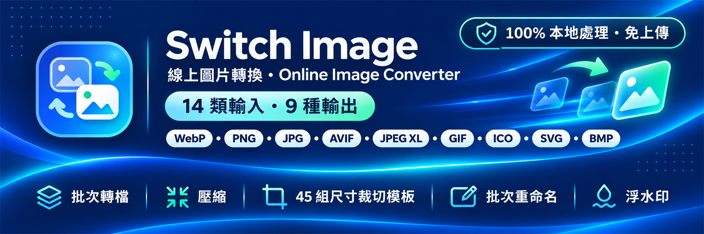

<div align="center">

<a href="https://switchimage.stack-base.com">
  
</a>

# Switch Image

**Lightning-Fast Universal Image Converter — 100% Local in Your Browser**

Batch convert, compress, resize, rename, and watermark images across **WebP, JPG, PNG, AVIF, GIF, ICO, SVG, BMP, and HEIC**.<br />
Zero-Build &bull; 4 Languages &bull; Light / Dark / System Theme &bull; Ad-Free &bull; Your files never leave your device.

<p>
  <a href="./README.md">繁體中文</a> &nbsp;|&nbsp; <strong>English</strong>
</p>

<p>
  <strong>🌐 <a href="https://switchimage.stack-base.com">Use Switch Image Online</a></strong>
</p>

<p>
  
  <a href="./LICENSE"></a>
  
  
  
  <a href="https://switchimage.stack-base.com"></a>
</p>

<p>
  <a href="#-key-features">Features</a> &bull;
  <a href="#-supported-formats--codec-matrix">Formats</a> &bull;
  <a href="#-quick-start">Quick Start</a> &bull;
  <a href="#-architecture--project-structure">Architecture</a> &bull;
  <a href="#-configuration--customization">Customization</a> &bull;
  <a href="#-deployment">Deployment</a> &bull;
  <a href="#-license">License</a>
</p>

</div>

---

## Overview

**Switch Image** is a pure client-side, zero-build static web application crafted for developers, designers, e-commerce teams, and content creators. Its modular vanilla HTML, CSS, and JavaScript architecture requires no package installation. All image processing and ZIP creation run locally in the browser; fallback HEIC/AVIF codec modules are loaded on demand only when native browser support is unavailable.

---

## ✨ Key Features

### Effortless Two-Step Workflow
- **Step 1: Pick target format** → **Step 2: Drag & drop images, entire folders, or paste screenshots with `Ctrl + V`** for instant conversion.
- **Smart Single vs. Batch Download**:
  - **1 image**: Primary CTA downloads the converted file directly without wrapping it in a ZIP archive.
  - **2+ images**: Automatically switches to one-click **ZIP Archive (`SwitchImage_Batch.zip`)**, alongside sequential individual downloads.
- **Per-Item Format Override**: Change the output format of individual images right inside the results queue.

### Cross-Device Craft & Progressive Disclosure UI
- **Built-in 4-Language i18n**: Instant switching across **Traditional Chinese (繁體中文), English, Japanese (日本語), and Spanish (Español)**—covering all UI controls, format descriptions, 45 size templates, modals, toasts, and `404.html`, with auto-detection and `localStorage` persistence.
- **3-Mode Icon Theme Switcher**: Tactile icon-based **Light / Dark / System** segmented control (☀ / 🌙 / 🖥) with live `prefers-color-scheme` sync.
- **Tool-First, Zero-Duplication Responsive Layout**:
  - Mobile keeps branding & intro within ~30% of the viewport so the core converter occupies 70%+ above the fold; language, theme, tips, and the 9-format matrix live in a single bottom sheet.
  - Desktop surfaces language and 3-mode icon theme controls directly in the topbar, opens an anchored About popover right below the `info` icon, and displays a borderless info footer—ensuring every control appears in exactly one place.
- **Offline-Ready PWA & OS-Tailored Install Experience**:
  - Ships with a relative-path Service Worker (`sw.js`) and full `manifest.json` for offline access to cached core conversion features. Browsers without native HEIC/AVIF support still need a network connection the first time a fallback codec is loaded.
  - **Gentle First-Visit Prompt**: Asks once on first visit via an unobtrusive floating corner card with platform-native terminology (Windows Desktop App, Mac App / Safari Add to Dock, iPhone/iPad Add to Home Screen, Android Home Screen, Linux Desktop) across all 4 languages.
  - **Low-Key Persistent Entry**: Quiet install entry tucked into the desktop footer or mobile bottom sheet when not yet installed, automatically hidden in standalone PWA mode.
- **Unified Design System & Built-In SEO**: Concentric rounded corners, `4px / 8px` spacing scale, external duotone SVG icons & illustrations, plus complete Open Graph, Twitter Card, `WebApplication` JSON-LD structured data, `<noscript>` fallback, and `robots.txt`.
- **Custom `404.html`**: Matching error page with GitHub Pages subpath awareness, i18n support, and 3-mode theme persistence.

### Output Lightbox Preview & Power Tools
- **Clean Output Lightbox**: Click any thumbnail to inspect the converted image (crop, background fill, watermark) at full viewport scale, and click the image to toggle 100% actual pixel zoom.
- **Multi-Select ICO Size Chips**: Freely toggle any combination of `16 / 32 / 48 / 64 / 128 / 256px` to pack into a single `.ico` file.
- **7 Quick Presets**: One-click presets for WebP optimization, ultra-compact AVIF, universal JPG, lossless PNG, multi-size favicon ICO, SVG vector tracing, and 1920px social sharing.
- **45 Cross-Platform Size Templates**: Filterable & searchable presets paired with **Contain (aspect fit)**, **Pad (centered canvas with fill)**, and **Cover (center crop)** resize modes.
- **Batch Renamer**: Custom prefix, suffix, unified base filename, and zero-padded sequential numbering with live preview and OS-safe filename sanitization.
- **Custom Text & Logo Watermarks**: Proportional font sizing, opacity, angle, transparent PNG/SVG logo overlays, and 6 placements including **full-canvas diagonal tiling**.

<details>
<summary><strong>Explore all 6 categories &amp; 45 built-in size templates</strong></summary>

| Category | Count | Platforms &amp; Dimensions |
| :--- | :---: | :--- |
| **E-Commerce** | 7 | Shopee (`800×800`, `1024×1024`, `1200×600`), momo / PChome (`1000×1000`), Pinkoi / 7-11 MyShip (`1200×1200`), Amazon (`2000×2000`), Shopify (`2048×2048`) |
| **Facebook** | 8 | 1:1 Square, 4:5 Portrait, Landscape Link, Page Standard &amp; 2x HD Cover, Group Cover, Event Cover, Story / Reels 9:16 |
| **Instagram** | 6 | 1:1 Square, 4:5 Portrait, 3:4 Profile Grid (`1080×1440`), 1.91:1 Landscape, Story / Reels 9:16, Avatar / Highlight Cover |
| **YouTube** | 7 | `1280×720` / `1920×1080` Thumbnails, `2560×1440` Channel Banner, `1546×423` Safe Area, Shorts 9:16, `800×800` Avatar, `150×150` Branding Watermark |
| **SEO &amp; Web** | 7 | Open Graph (`1200×630`), Google Discover 4:3 (`1200×900`), X Card (`1200×675`), Blog Hero (`1600×900`), PWA `512×512`, Apple Touch `180×180`, Multi-size `favicon.ico` |
| **Niche &amp; Utility** | 10 | Google Forms Header (`1600×400`), Google Classroom (`1000×250`), LINE Rich Menu Large / Small (`2500×1686`, `2500×843`), LINE Sticker (`370×320`), Notion Cover (`1500×600`), X Header (`1500×500`), LinkedIn Banner (`1584×396`), Discord Banner (`960×540`), Presentation 16:9 (`1920×1080`) |

</details>

---

## 🧩 Supported Formats & Codec Matrix

RAW, DNG, CR2, CR3, NEF, and ARW can convert embedded JPEG previews. The result shows the preview resolution and uses its pixels. To convert Lightroom edits, export a JPEG or TIFF from Lightroom first.

PSD, TIFF/TIF, JPEG XL, and TGA are input formats for preview and batch conversion. PSD uses the saved 8-bit composite. TIFF converts the first page of common 8-bit RGB/RGBA or 1-/8-bit grayscale files. TGA supports uncompressed and RLE true-color files. JPEG XL is also a still-image output format with adjustable quality, transparency, and an on-demand encoder.

Open the app over HTTP(S) for worker-based decoding. The PSD, TIFF, and JPEG XL fallback decoders are fetched on demand, and files are processed locally. These inputs are limited to 128 MiB, 40 megapixels, and 16,383 pixels per side.

| Format | Decode | Encode | Alpha | Engine &amp; Implementation Details |
| :--- | :---: | :---: | :---: | :--- |
| **WebP** | ✅ | ✅ Native | ✅ | Native browser Canvas encoder with lossy quality control (default 85%) |
| **PNG** | ✅ | ✅ Native | ✅ | Native lossless Canvas encoder preserving full alpha transparency |
| **JPG / JPEG** | ✅ | ✅ Native | ❌ | Native Canvas encoder with automatic matte background fill (white, black, or custom) |
| **AVIF** | ✅ | ✅ Native / WASM | ✅ | Uses native browser AVIF encoding when available; loads WASM encoder on demand as fallback |
| **GIF** | ✅ | ✅ Pure JS | ✅ | Built-in zero-dependency GIF89a encoder (Median-Cut 256-color quantization + transparency + LZW) |
| **ICO** | ✅ | ✅ Pure JS | ✅ | Built-in multi-resolution PNG-in-ICO packer (`16 / 32 / 48 / 256px` or single-size) |
| **SVG** | ✅ | ✅ Pure JS | ✅ | High-DPI SVG rasterization; raster-to-SVG supports both lossless embedded wrapper and pure vector color-region tracing |
| **BMP** | ✅ | ✅ Pure JS | ❌ | Standard uncompressed 24-bit Windows BMP encoder |
| **HEIC / HEIF** | ✅ | Convert out | ✅ | Native Safari decoding; loads `heic2any` on demand in Chromium/Firefox to convert to any output format |

---

## 🚀 Quick Start

### Option 1: Use the Live App (Recommended)

Open **<https://switchimage.stack-base.com>**, select an output format, and drop in your images. No account, sign-in, or file upload is required.

### Option 2: Run Locally

No build step or dependency installation is required:

```bash
git clone https://github.com/bruce-yang-422/Switch-Image.git
cd Switch-Image
```

Start any static server:

```bash
# Node.js
npx serve .

# Python 3
python -m http.server 8080

# PHP
php -S localhost:8080
```

Open the local URL printed by the command (`http://localhost:8080` for the Python and PHP examples). You can also double-click `index.html` to use the embedded fallback configuration in `file://` mode, but PWA installation, Service Workers, and some HEIC/AVIF fallback behavior require HTTP(S) and network access.

---

## 📁 Architecture & Project Structure

Markup, CSS design tokens, JSON configuration, SVG assets, i18n, and codec modules remain cleanly separated. Neither `index.html` nor `404.html` contains inline CSS, executable JavaScript, or SVG; `index.html` only embeds the JSON-LD structured data required for SEO:

```text
Switch-Image/
├── index.html                           # Entry HTML (SEO Meta / JSON-LD; no inline executable CSS / JS / SVG)
├── 404.html                             # Custom 404 page (GitHub Pages, i18n & 3-mode theme ready)
├── robots.txt                           # Search crawler directives
├── LICENSE                              # MIT License (Copyright © Bruce Yang)
├── README.md                            # Traditional Chinese Documentation
├── README.en.md                         # English Documentation
├── manifest.json                        # PWA Web App Manifest
├── sw.js                                # Service Worker (offline asset caching & standalone PWA)
├── CNAME                                # GitHub Pages custom domain
├── .nojekyll                            # Disables Jekyll processing on GitHub Pages
├── .github/
│   └── workflows/
│       └── deploy-pages.yml             # GitHub Actions Pages deployment workflow
├── assets/
│   ├── brand/                           # Brand identity, PWA icon, SEO cover & README banner
│   ├── favicon/                         # Browser & device icons (favicon.ico, apple-touch-icon.png)
│   ├── icons/                           # External rounded duotone UI SVG icons
│   └── illustrations/                   # Custom SVG dropzone & 404 illustrations
├── data/
│   ├── formats.json                     # 9 image format specs, MIME types, ICO/SVG options
│   ├── presets.json                     # 7 quick format & quality presets
│   └── ecommerce-templates.json         # 6 categories, 45 platform size templates
├── css/
│   ├── tokens.css                       # Light/dark theme tokens, concentric radii, 4px/8px spacing & control heights
│   ├── base.css                         # Reset, ambient backdrop, tactile cards, buttons & form controls
│   ├── hero.css                         # Minimal topbar, language picker, 3-mode icon theme control & responsive hero
│   ├── layout.css                       # Two-step studio card, smart dropzone, optional tool dock & borderless footer
│   ├── components.css                   # File list, template library, About/Settings drawer, compare modal & toast
│   └── error.css                        # 404 page styles
└── js/
    ├── config/defaults.js               # Offline fallback configs for file:// execution
    ├── utils/                           # formatters, renamer, folder-reader, download, zip-builder
    ├── decoders/                        # image-decoder (with SVG normalization), heic-decoder
    ├── encoders/                        # canvas-encoder (with AVIF WASM fallback), gif / ico / svg / bmp encoders
    ├── core/                            # i18n (4 locales), capabilities, watermark, store, converter
    ├── ui/                              # theme, toast, settings-panel, advanced-tools, file-list, compare-modal, format-matrix, site-info-modal, pwa-install, error-page
    └── app.js                           # Application bootstrap & event wiring
```

---

## ⚙️ Configuration & Customization

Formats, presets, size templates, and locales are modular and easy to extend:

| Task | File to Edit | Notes |
| :--- | :--- | :--- |
| Add or edit size templates | [`data/ecommerce-templates.json`](./data/ecommerce-templates.json) | Configure category, dimensions, resize mode (`contain` / `pad` / `cover`), format, and filename suffix |
| Customize quick presets | [`data/presets.json`](./data/presets.json) | Define one-click format, quality, and dimension profiles |
| Adjust format defaults | [`data/formats.json`](./data/formats.json) | Modify default quality, ICO size bundles, or SVG export modes |
| Add or edit UI languages | [`js/core/i18n.js`](./js/core/i18n.js) | Ships with `zh-Hant`, `en`, `ja`, and `es`; extend using the same key dictionary |
| Keep offline `file://` in sync | [`js/config/defaults.js`](./js/config/defaults.js) | Mirror JSON updates here if you rely on opening `index.html` without an HTTP server |

---

## 🌐 Deployment

All asset paths are relative (`./`), so Switch Image can be hosted at a root domain, a GitHub Pages subpath, or another static hosting service without a build command.

### Current Production Deployment

- Live website: <https://switchimage.stack-base.com>
- Source repository: <https://github.com/bruce-yang-422/Switch-Image>
- Hosting: GitHub Pages
- Deployment branch: `main`
- Workflow: [`.github/workflows/deploy-pages.yml`](./.github/workflows/deploy-pages.yml)
- Custom domain: configured through [`CNAME`](./CNAME)

Every push to `main` automatically deploys the latest site through GitHub Actions. The included `404.html` provides the custom error page.

### Deploy Your Own Fork

1. Fork this repository, then set **Settings → Pages → Build and deployment → Source** to **GitHub Actions** in your fork.
2. Remove or update `CNAME` when using the default GitHub Pages URL; replace it with your own domain when using a custom domain.
3. Push to your fork's `main` branch to deploy automatically with the included workflow.

### Other Static Hosts

Deploy the repository root (`.`) directly to **Cloudflare Pages**, **Netlify**, **Vercel**, or any static web server with no build command required.

---

## 🔒 Privacy & Security

- **100% Client-Side Execution**: Image decoding, resizing, watermarking, format encoding, and ZIP creation all run strictly inside browser memory. No image data is ever transmitted to any server.
- **Zero Tracking**: No analytics scripts, no tracking cookies, and no third-party ads.
- **On-Demand Codec Loading**: PSD and TIFF use external JavaScript decoders. JPEG XL, AVIF, and HEIC load fallback codecs when needed.

---

## 🌍 Browser Compatibility

Works on all modern evergreen browsers (**Chrome / Edge 90+**, **Firefox 90+**, **Safari 15+**). Live browser codec capabilities are detected automatically at startup via `js/core/capabilities.js`.

---

## 📄 License

This project is licensed under the **[MIT License](./LICENSE)** — Copyright © 2026 **Bruce Yang**. See the [`LICENSE`](./LICENSE) file for details.

---

<div align="center">
  <sub>Switch Image v0.1.1 &bull; Built with pure Web Standards — HTML5 Canvas, Modular CSS Design Tokens &amp; Vanilla JavaScript.</sub>
</div>
