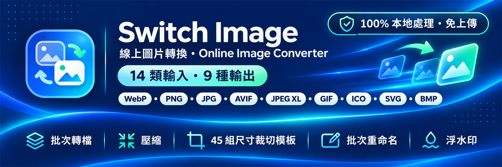

<div align="center">

<a href="https://switchimage.stack-base.com">
  
</a>

# Switch Image

**100% 瀏覽器本地運算的萬能圖片格式極速互轉工具**

支援 **WebP、JPG、PNG、AVIF、GIF、ICO、SVG、BMP、HEIC** 批次互轉、畫質壓縮、尺寸裁切、批次重命名與自訂浮水印。<br />
免建置（Zero-Build）・四國語言介面・三態主題切換・純淨無廣告・檔案絕不離開您的裝置。

<p>
  <strong>繁體中文</strong> &nbsp;|&nbsp; <a href="./README.en.md">English</a>
</p>

<p>
  <strong>🌐 <a href="https://switchimage.stack-base.com">線上使用 Switch Image</a></strong>
</p>

<p>
  
  <a href="./LICENSE"></a>
  
  
  
  <a href="https://switchimage.stack-base.com"></a>
</p>

<p>
  <a href="#-核心特色">核心特色</a> &bull;
  <a href="#-支援格式與編解碼矩陣">支援格式</a> &bull;
  <a href="#-快速開始">快速開始</a> &bull;
  <a href="#-專案架構">專案架構</a> &bull;
  <a href="#-自訂與擴充">自訂擴充</a> &bull;
  <a href="#-部署指南">部署指南</a> &bull;
  <a href="#-授權條款">授權條款</a>
</p>

</div>

---

## 簡介

**Switch Image** 是一個專為開發者、設計師、電商營運與內容創作者打造的純前端靜態圖像處理工作台。全站採用免建置（Zero-Build）、免安裝套件的模組化原生 HTML / CSS / JavaScript 架構。所有圖片處理與 ZIP 打包皆於瀏覽器本地完成，額外編解碼模組按需載入。

---

## ✨ 核心特色

### 極速兩步驟工作流
- **步驟 ① 選擇目標格式** → **步驟 ② 拖放圖片、整個資料夾或 `Ctrl + V` 貼上截圖**，即時完成轉換。
- **智慧單檔／批次下載切換**：
  - 放入 **1 張圖片**：主操作按鈕自動切換為「直接下載」，避免多餘 ZIP 封裝。
  - 放入 **2 張以上**：自動切換為「打包下載 ZIP」（`SwitchImage_Batch.zip`），同時提供「逐一下載」。
- **單張獨立格式覆寫**：批次轉換期間，可於結果清單右側為個別圖片切換不同輸出格式。

### 跨裝置質感設計與漸進式揭露（Progressive Disclosure）
- **多國語言即時切換（4 語系）**：內建 **繁體中文、English、日本語、Español** 完整語系引擎（含所有格式標籤、45 組尺寸模板、彈窗、提示與 404 頁），自動偵測瀏覽器語系並持久化偏好。
- **亮色／暗色／隨系統三態圖示切換**：PC 頂部與設定抽屜提供純圖示三段切換器（☀／🌙／🖥），即時監聽作業系統 `prefers-color-scheme` 變化。
- **行動優先與零重複介面**：
  - 手機端頂部品牌與介紹精簡控制在首屏約 30% 內，70% 以上保留給核心轉檔工作台；語言、主題、使用小撇步與 9 大格式能力整合至底部抽屜（Bottom Sheet）。
  - PC 端由導覽列直接切換語言與三態主題，`info` 圖示正下方展開浮動網站資訊 Popover，底部呈現無框頁尾，同一功能絕不重複出現。
- **PWA 離線應用與跨平台客製安裝引導**：
  - 內建 Service Worker（`sw.js`）與完整 `manifest.json`，安裝後可離線使用已快取的核心轉檔功能；缺少原生支援的 HEIC／AVIF 備援模組首次載入時仍需網路。
  - **首次造訪溫和提示**：僅於首次造訪時於角落低調詢問安裝，並依作業系統與瀏覽器客製對應說法（Windows 桌面版、Mac 應用／Safari 加入 Dock、iPhone/iPad 加入主畫面、Android 手機主畫面、Linux 桌面版），且同步四國語系。
  - **低調常駐入口**：未安裝時僅於 PC 頁尾或手機底部設定抽屜提供低調入口，不干擾主工作台，安裝完成後自動隱藏。
- **統一視覺系統與 SEO 優化**：同心圓弧角（Concentric Radii）、`4px / 8px` 間距規範、獨立圓角雙色 SVG 圖示／插畫；內建 Open Graph、Twitter Card、`WebApplication` JSON-LD 結構化資料、`<noscript>` 友善提示與 `robots.txt`。
- **自訂 404 頁面**：內建與全站風格一致的 `404.html`，支援 GitHub Pages 子路徑返回、多語系與三態主題同步。

### 成品大圖預覽與進階工具
- **純淨大圖預覽燈箱**：點擊任一縮圖即可大圖檢視轉換成品（確認裁切、補底色與浮水印），點擊圖片可切換 100% 原吋像素檢視。
- **ICO 多尺寸自由複選**：支援自由勾選 `16 / 32 / 48 / 64 / 128 / 256px` 任意組合封裝為單一 `.ico`。
- **7 組常用快速組合**：網頁 WebP、極致 AVIF、通用 JPG、無損 PNG、網站 Favicon、Logo 向量化與社群縮圖一鍵套用。
- **45 組跨平台尺寸庫**：支援分類篩選與即時關鍵字搜尋，提供**等比縮放**、**固定畫布置中補底色**與**滿版置中裁切**三種模式。
- **批次重命名引擎**：支援前綴、後綴、統一主檔名、自訂起始值與補零位數流水號，並即時預覽與過濾非法系統檔名字元。
- **文字／Logo 浮水印**：支援相對圖寬字級、透明度、旋轉角度、透明 PNG / SVG Logo，以及四角、正中與**全圖斜向滿版平鋪**共 6 種版位。

<details>
<summary><strong>展開查看內建 6 大分類、45 組尺寸庫清單</strong></summary>

| 分類 | 數量 | 涵蓋平台與常用規格 |
| :--- | :---: | :--- |
| **電商平台** | 7 | 蝦皮 Shopee (`800×800`, `1024×1024`, `1200×600`)、momo / PChome (`1000×1000`)、Pinkoi / 賣貨便 (`1200×1200`)、Amazon (`2000×2000`)、Shopify (`2048×2048`) |
| **Facebook** | 8 | 貼文 1:1 / 4:5 / 橫式連結、粉專標準與 2x 高清封面、社團封面、活動封面、限動 / Reels 9:16 |
| **Instagram** | 6 | 1:1 正方形、4:5 直式貼文、3:4 新版主頁網格 (`1080×1440`)、1.91:1 橫式、限動 / Reels 9:16、頭像／精選封面 |
| **YouTube** | 7 | 1280×720 / 1920×1080 縮圖、2560×1440 頻道橫幅、1546×423 安全區、Shorts 9:16、800×800 頭像、150×150 訂閱浮水印 |
| **SEO / 網站** | 7 | Open Graph (`1200×630`)、Google Discover 4:3 (`1200×900`)、X Card (`1200×675`)、部落格主圖 (`1600×900`)、PWA `512×512`、Apple Touch `180×180`、多尺寸 `favicon.ico` |
| **冷門／表單・LINE** | 10 | Google 表單頁首 (`1600×400`)、Google Classroom (`1000×250`)、LINE 大／小型圖文選單 (`2500×1686`, `2500×843`)、LINE 貼圖 (`370×320`)、Notion (`1500×600`)、X 橫幅 (`1500×500`)、LinkedIn (`1584×396`)、Discord (`960×540`)、簡報 16:9 (`1920×1080`) |

</details>

---

## 🧩 支援格式與編解碼矩陣

RAW、DNG、CR2、CR3、NEF、ARW 支援內嵌 JPEG 預覽轉檔。輸出使用預覽的像素，結果列會標示預覽解析度。Lightroom 目錄與 XMP 的調整設定不會套用到輸出，請先在 Lightroom 匯出 JPEG 或 TIFF，以使用調整後的影像。

PSD、TIFF／TIF、JPEG XL 和 TGA 可作為輸入，並沿用批次轉檔及預覽。PSD 使用已儲存的 8 位元合成圖，TIFF 使用常見 8 位元 RGB／RGBA 或 1／8 位元灰階的第一頁，TGA 支援未壓縮及 RLE 真彩色。JPEG XL 也可作為靜態圖片輸出，支援畫質調整與透明背景，編碼模組按需下載。

請從 HTTP(S) 開啟以使用專業格式的背景解碼器。PSD、TIFF 與 JPEG XL 備援模組透過 CDN 按需下載，原始檔在瀏覽器本地處理。這四種格式的輸入上限為 128 MiB、4,000 萬像素及單邊 16,383 像素。

| 格式 | 讀入解碼 | 輸出編碼 | 透明通道 | 實作引擎與技術說明 |
| :--- | :---: | :---: | :---: | :--- |
| **WebP** | ✅ | ✅ 原生 | ✅ | 瀏覽器原生 Canvas 編碼，支援有損畫質微調（預設 85%） |
| **PNG** | ✅ | ✅ 原生 | ✅ | 瀏覽器原生無損編碼，完整保留 Alpha 透明背景 |
| **JPG / JPEG** | ✅ | ✅ 原生 | ❌ | 瀏覽器原生編碼，自動填入指定底色（白底／黑底／自訂色）避免透明區域變黑 |
| **AVIF** | ✅ | ✅ 原生／WASM | ✅ | 優先使用瀏覽器原生編碼；不支援時自動按需載入 WASM 編碼器備援 |
| **GIF** | ✅ | ✅ 純 JS | ✅ | 內建零依賴 GIF89a 編碼器（Median-Cut 256 色量化 + 透明色索引 + LZW 壓縮） |
| **ICO** | ✅ | ✅ 純 JS | ✅ | 內建多尺寸 PNG-in-ICO 封裝器（支援 `16 / 32 / 48 / 256px` 與單一尺寸） |
| **SVG** | ✅ | ✅ 純 JS | ✅ | 支援 SVG 高解析柵格化；點陣轉 SVG 提供「高畫質內嵌封裝」與「純向量色塊追蹤」雙模式 |
| **BMP** | ✅ | ✅ 純 JS | ❌ | 標準 24-bit Windows BMP 未壓縮點陣編碼器 |
| **HEIC / HEIF** | ✅ | 轉出他檔 | ✅ | Safari 原生解碼；其餘瀏覽器按需載入 `heic2any` 解碼並輸出任意支援格式 |

---

## 🚀 快速開始

### 方式一：直接線上使用（推薦）

開啟 **<https://switchimage.stack-base.com>**，選擇輸出格式後拖入圖片即可轉換。無需註冊、登入或上傳檔案。

### 方式二：在本機執行

本專案無需建置或安裝相依套件：

```bash
git clone https://github.com/bruce-yang-422/Switch-Image.git
cd Switch-Image
```

啟動任一靜態伺服器：

```bash
# Node.js
npx serve .

# Python 3
python -m http.server 8080

# PHP
php -S localhost:8080
```

啟動後於瀏覽器開啟終端機顯示的本機網址（Python／PHP 範例為 `http://localhost:8080`）。也可直接雙擊 `index.html` 以 `file://` 模式使用內建備援設定，但 PWA 安裝、Service Worker 與部分 HEIC／AVIF 備援功能需要 HTTP(S) 與網路環境。

---

## 📁 專案架構

嚴格分離結構（HTML）、設計系統（CSS）、設定資料（JSON）、視覺資產（SVG）與編解碼／多語核心（JS）；`index.html` 與 `404.html` 均不含行內 CSS、可執行 JavaScript 或 SVG（`index.html` 僅內嵌 SEO 所需的 JSON-LD 結構化資料）：

```text
Switch-Image/
├── index.html                           # 主入口頁面（SEO Meta / JSON-LD，無行內可執行 CSS / JS / SVG）
├── 404.html                             # 自訂 404 頁面（支援 GitHub Pages、多語系與三態主題）
├── robots.txt                           # 搜尋引擎爬蟲索引設定
├── LICENSE                              # MIT 開源授權條款（Copyright © Bruce Yang）
├── README.md                            # 繁體中文說明文件
├── README.en.md                         # English Documentation
├── manifest.json                        # PWA Web App Manifest
├── sw.js                                # Service Worker（離線快取與獨立應用支援）
├── CNAME                                # GitHub Pages 自訂網域設定
├── .nojekyll                            # 停用 GitHub Pages Jekyll 建置
├── .github/
│   └── workflows/
│       └── deploy-pages.yml             # GitHub Actions 自動部署設定
├── assets/
│   ├── brand/                           # 品牌識別、PWA 圖示、SEO 分享圖與 README 橫幅
│   ├── favicon/                         # 裝置與分頁圖示（favicon.ico、apple-touch-icon.png）
│   ├── icons/                           # 獨立圓角雙色 UI SVG 圖示（含語言、三態主題、導覽）
│   └── illustrations/                   # 拖放區與 404 頁客製 SVG 插畫
├── data/
│   ├── formats.json                     # 9 大圖像格式規格、MIME、ICO / SVG 選項
│   ├── presets.json                     # 7 組快速壓縮與格式組合預設
│   └── ecommerce-templates.json         # 6 大分類、45 組社群／電商／SEO／工具尺寸庫
├── css/
│   ├── tokens.css                       # 淺深色主題色票、同心圓角、4px/8px 間距與元件高度變數
│   ├── base.css                         # Reset、微光背景、卡片材質、按鈕與表單控制項
│   ├── hero.css                         # 極簡導覽列、語言切換、三態主題圖示列與響應式 Hero
│   ├── layout.css                       # 兩步驟工作台、智慧收合拖放區、微調抽屜與無框頁尾
│   ├── components.css                   # 檔案清單、尺寸庫卡片、關於／設定抽屜、滑動對比 Modal、Toast
│   └── error.css                        # 404 頁面樣式
└── js/
    ├── config/defaults.js               # file:// 離線開啟時的設定檔備援資料
    ├── utils/                           # formatters、renamer、folder-reader、download、zip-builder
    ├── decoders/                        # image-decoder（含 SVG 正規化）、heic-decoder
    ├── encoders/                        # canvas-encoder（含 AVIF WASM）、gif / ico / svg / bmp encoder
    ├── core/                            # i18n（4 語系引擎）、capabilities、watermark、store、converter
    ├── ui/                              # theme、toast、settings-panel、advanced-tools、file-list、compare-modal、format-matrix、site-info-modal、pwa-install、error-page
    └── app.js                           # 應用程式啟動與全域事件綁定
```

---

## ⚙️ 自訂與擴充

所有格式規格、快速預設、尺寸模板與多國語系均為模組化設計：

| 需求 | 編輯檔案 | 說明 |
| :--- | :--- | :--- |
| 新增／調整尺寸模板 | [`data/ecommerce-templates.json`](./data/ecommerce-templates.json) | 支援自訂分類、寬高、縮放模式（`contain` / `pad` / `cover`）、預設格式與檔名後綴 |
| 調整常用快速組合 | [`data/presets.json`](./data/presets.json) | 自訂一鍵套用的格式、畫質與最大尺寸限制 |
| 修改格式預設畫質或選項 | [`data/formats.json`](./data/formats.json) | 調整預設品質、ICO 封裝尺寸與 SVG 模式選項 |
| 擴充或修改介面語系 | [`js/core/i18n.js`](./js/core/i18n.js) | 內建 `zh-Hant`、`en`、`ja`、`es`，可依相同鍵值新增更多語系 |
| 同步離線 `file://` 備援 | [`js/config/defaults.js`](./js/config/defaults.js) | 若需支援直接雙擊 `index.html` 離線讀取新資料，請同步更新此檔 |

---

## 🌐 部署指南

全站資源均採用相對路徑（`./`），可部署至根網域、GitHub Pages 子路徑或其他靜態託管平台，無需建置指令。

### 目前正式部署

- 正式網站：<https://switchimage.stack-base.com>
- 原始碼：<https://github.com/bruce-yang-422/Switch-Image>
- 託管平台：GitHub Pages
- 部署來源：`main` 分支
- 自動部署：[`.github/workflows/deploy-pages.yml`](./.github/workflows/deploy-pages.yml)
- 自訂網域：由 [`CNAME`](./CNAME) 設定

每次推送至 `main` 後，GitHub Actions 會自動部署最新版網站，`404.html` 則作為自訂錯誤頁面。

### 部署自己的 Fork

1. Fork 此 repository，並在 Fork 的 **Settings → Pages → Build and deployment** 將 **Source** 設為 **GitHub Actions**。
2. 若使用 GitHub Pages 預設網址，請移除或修改 `CNAME`；若使用自訂網域，請將 `CNAME` 改成自己的網域。
3. 推送至 Fork 的 `main` 分支，即會透過內建 workflow 自動部署。

### 其他靜態託管平台

可直接以根目錄 `.` 部署至 **Cloudflare Pages**、**Netlify**、**Vercel** 或任何 Nginx / Caddy 靜態伺服器（無需 Build Command）。

---

## 🔒 隱私與安全

- **100% 本地處理**：圖片解碼、縮放、浮水印合成、格式編碼與 ZIP 打包皆完全在使用者瀏覽器記憶體中完成，絕不上傳任何圖片資料至外部伺服器。
- **零追蹤與零廣告**：不含第三方分析腳本、追蹤 Cookie 或廣告程式碼。
- **按需載入解碼模組**：PSD 和 TIFF 使用前端 JS 解碼器，JPEG XL、AVIF 和 HEIC 在需要時載入備援模組。

---

## 🌍 瀏覽器相容性

支援所有現代常青瀏覽器（**Chrome / Edge 90+**、**Firefox 90+**、**Safari 15+**），並於啟動時透過 `js/core/capabilities.js` 自動偵測當前環境的 WebP / AVIF 編碼能力。

---

## 📄 授權條款

本專案採用 **[MIT License](./LICENSE)** 開源授權 — Copyright © 2026 **Bruce Yang**。詳情請參閱 [`LICENSE`](./LICENSE) 檔案。

---

<div align="center">
  <sub>Switch Image v0.1.1 &bull; Built with pure Web Standards — HTML5 Canvas, Modular CSS Design Tokens &amp; Vanilla JavaScript.</sub>
</div>
